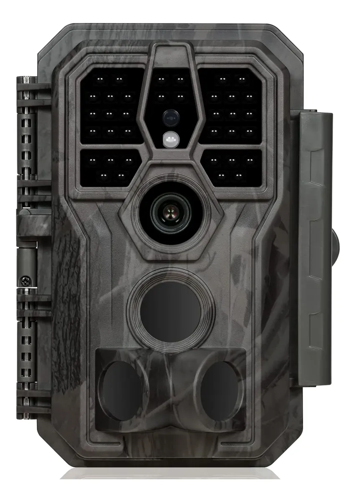

Em **agosto de 2020**, um estalo de curiosidade e paixão pela fauna silvestre se transformou em ação. Foi nesse exato momento que instalei a minha primeiríssima câmera de trilha na região de Araraquara, interior de São Paulo. Naquela época, o projeto que hoje vocês conhecem era apenas um desejo de registrar o invisível e documentar a rica biodiversidade que resiste e habita os fragmentos de mata da nossa região.

Para dar esse pontapé inicial, apostei em um equipamento que, na época, precisei importar diretamente dos Estados Unidos por conta própria: a **GardePro E5**.

### Por que a GardePro E5?

Quando comecei a pesquisar sobre monitoramento não-invasivo, queria algo que unisse resistência, boa camuflagem e, principalmente, uma velocidade de disparo que não perdesse os animais mais rápidos. A GardePro E5 se mostrou a parceira ideal para essa estreia por alguns motivos:

* **Disparo veloz:** Tempo de resposta rápido para flagrar a fauna em movimento.
* **Visão noturna invisível:** Essencial para capturar os hábitos de mamíferos sem assustá-los ou revelar a presença do equipamento.
* **Resistência ao clima:** Aguentando o calor intenso, as chuvas fortes e a umidade das matas de Araraquara.

### O Início de uma Jornada

Começar com uma única câmera ensina muito sobre paciência e leitura de ambiente. Cada escolha de árvore, cada trilha de passagem (carreador) e cada ajuste de altura contava. Não havia a facilidade de múltiplos pontos; era um único "olhar" eletrônico confiado à mata, gerando aquela expectativa sem igual a cada vez que eu voltava para buscar o cartão SD.

Esse primeiro passo, dado há anos, foi a semente de tudo. O que começou com uma GardePro E5 importada e muita curiosidade hoje se transformou em um inventário contínuo e emocionante da nossa fauna local.

Seja bem-vindo ao blog! Daqui para a frente, você vai acompanhar por aqui os frutos dessa jornada que começou lá atrás, em agosto de 2020. 

---

*Acompanhe também nossos registros e interações científicas no [iNaturalist](https://www.inaturalist.org/people/polones) e no nosso projeto de catalogação [Fauna de Araraquara](https://www.inaturalist.org/projects/fauna-de-araraquara-sp-mamiferos-e-repteis).*